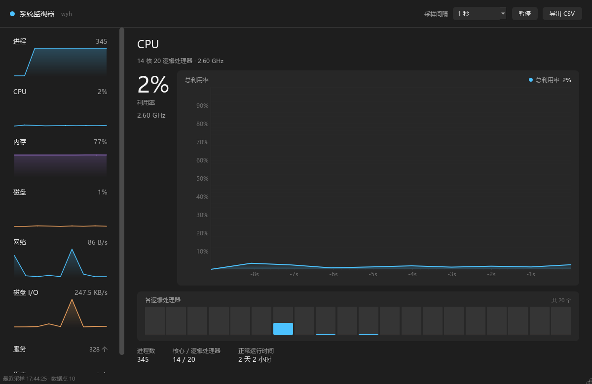

# 系统监视器（SysMon）

基于 **Python + psutil + PySide6** 的 Windows 系统性能监控桌面程序，界面参照 Windows 11 任务管理器「性能」页的布局与交互。


> **代码库地址**：<https://github.com/wyhsjztd/psutil>



## 功能

| 页面 | 内容 |
|---|---|
| 进程 | 全部进程列表（名称 / PID / CPU / 内存），支持搜索、表头排序、右键结束任务 |
| CPU | 总利用率实时曲线、每逻辑处理器柱状图、频率、进程数 / 正常运行时间 |
| 内存 | 使用率曲线、已用 / 可用 / 总计、交换（分页）文件 |
| 磁盘 | 活动时间占比（与任务管理器同义）、各分区容量使用率、读写吞吐曲线 |
| 网络 | 收发速率双曲线、累计流量、TCP 连接数 |
| 磁盘 I/O | 读写速率双曲线、累计读写量 |
| 服务 | Windows 服务列表（名称 / 显示名称 / 状态 / 启动类型），支持搜索 |
| 用户 | 当前登录用户与会话 |

### 采样设计

- 默认 1 秒采样，可切换 1 / 2 / 5 秒
- CPU 利用率取 Windows 性能计数器的 `% Processor Utility`，与任务管理器同口径
- 速率类指标（网络、磁盘 I/O）由累计计数器差分得到
- 暂停恢复、切换采样间隔时自动重建基线，首帧显示 `--`，不会出现虚假尖峰
- 曲线 x 轴为真实时间，窗口固定 60 秒
- 历史缓存 1 小时，可完整导出 CSV

### 性能设计

- 采集全部在独立线程完成，UI 线程只渲染，二者通过信号传递冻结快照
- 进程表使用 `QAbstractTableModel` 而非 `QTableWidget`：后者每 3 秒要重建上千个单元格对象，
  实测 340+ 进程时单次重建可达数秒，会把界面卡住
- 进程遍历只在"进程"页保持 3 秒刷新，切到其他页面降为 10 秒
- 实测：UI 线程单帧耗时 p95 由 6031 ms 降至 13 ms，采样间隔抖动 < 100 ms

## 运行

```bash
# 1. 创建虚拟环境（推荐）
python -m venv .venv
.venv\Scripts\activate

# 2. 安装依赖
pip install -r requirements.txt

# 3. 启动
python main.py
```

要求 Python 3.10 及以上。

### 打包为 exe

双击运行 `build_exe.bat`，产物为 `dist\SysMon.exe`（单文件、无控制台窗口，可直接双击启动）。

脚本会自动创建 `.venv-build` 干净虚拟环境再打包。**这一步不能省**：
PyInstaller 会沿依赖链扫描，若直接用开发机上的全局环境，
很容易把其他项目的重型依赖（实测把 torch、cv2、scipy 等约 1 GB 打了进去，
产物体积从 90 MB 膨胀到 444 MB）一并收进 exe。

手动执行等价命令（在干净虚拟环境中）：

```bash
python -m venv .venv-build
.venv-build\Scripts\pip install -r requirements-build.txt
.venv-build\Scripts\python -m PyInstaller --noconfirm --clean --onefile --windowed ^
  --name SysMon --icon assets\icon.ico ^
  --add-data "assets\icon.png;assets" main.py
```

> 单文件模式启动时需要先把运行库解压到临时目录，首次启动约 2–4 秒；
> 若更看重启动速度，把 `--onefile` 换成 `--onedir`，产物是文件夹，启动约 1 秒。

## 测试

核心速率算法与告警逻辑与 psutil、Qt 完全解耦，可单独测试：

```bash
python -m unittest discover -s tests -v
```

## 项目结构

```
psutil/
├── main.py                  # 入口
├── sysmon/
│   ├── models.py            # 冻结数据模型
│   ├── engine.py            # 速率计算 / 历史窗口 / 告警（纯逻辑）
│   ├── collector.py         # psutil 采集封装
│   ├── winperf.py           # PDH 性能计数器（CPU 利用率、磁盘活动时间）
│   ├── worker.py            # 采样线程
│   ├── services.py          # 服务采集线程（WMI 较慢，独立运行）
│   └── ui/
│       ├── theme.py         # 配色与 QSS
│       ├── widgets.py       # 导航卡片 / 迷你曲线 / 分区行
│       ├── charts.py        # pyqtgraph 曲线卡片
│       ├── pages.py         # 八个功能页面
│       └── main_window.py   # 主窗口
├── tests/test_engine.py
├── docs/
│   ├── 系统文档.md
│   ├── 设计文档.md
│   └── 用户手册.md
└── requirements.txt
```

## 文档

- [系统文档](docs/系统文档.md)：AI 工具、技术栈、已实现功能、用户操作手册（提交用总文档）
- [设计文档](docs/设计文档.md)：技术选型、架构设计、指标定义、关键算法
- [用户手册](docs/用户手册.md)：安装、使用、常见问题

## 已知限制

- 仅在 Windows 11 上验证，其他平台的磁盘分区与服务页行为可能不同
- 网络速率为所有网卡汇总值，包含回环与虚拟网卡
- 服务页依赖 WMI，刷新间隔为 30 秒
- 进程 CPU 占用为采样区间内的平均值（3 秒），与任务管理器的瞬时值存在细微差异
- 不持久化历史数据，关闭程序后清空

## 开发说明

本项目借助 AI 编程助手完成开发：**Claude Code**（助手框架）+ **DeepSeek**（底层大模型），
用于需求拆解、代码编写与调试、文档撰写。所有关键读数均已与 Windows 任务管理器、
性能监视器逐项对照验证。详见 [系统文档 · 一、所用的 AI 工具](docs/系统文档.md)。

## License

[MIT](LICENSE)
