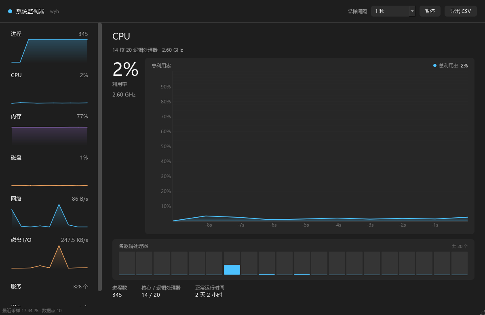

# 系统监视器（SysMon）系统文档

| 项目 | 内容 |
|---|---|
| 项目名称 | 系统监视器（SysMon） |
| 代码库地址 | <https://github.com/wyhsjztd/psutil> |
| 开发语言 | Python 3.10+（开发与验证环境为 3.12.10） |
| 运行平台 | Windows 10 / 11（64 位） |
| 开源许可 | MIT |
| 文档版本 | v1.0（2026-11-06） |

本文档面向**验收与使用**，覆盖：AI 工具使用情况、开发框架与技术、已实现的主要功能、用户操作手册。
更深入的算法与取舍细节见 [设计文档](设计文档.md)，日常操作速查见 [用户手册](用户手册.md)。

---

## 一、所用的 AI 工具

本项目在开发过程中使用了 AI 编程助手，具体如下：

| 项目 | 说明 |
|---|---|
| 助手框架 | **Claude Code**（Anthropic 的命令行 AI 编程助手） |
| 底层大模型 | **DeepSeek** 大模型 |
| 使用方式 | 在项目目录中通读代码库、生成与修改源码、定位缺陷、撰写文档、执行构建与验证 |

**AI 参与的具体工作：**

1. **需求拆解与技术选型**：确定 psutil 采集 + PySide6 渲染 + pyqtgraph 绘图的组合，划分纯逻辑层与 UI 层；
2. **代码生成**：数据模型、采集器、采样线程、八个页面、样式表、打包脚本均在此基础上完成；
3. **缺陷定位**：进程表卡顿（单帧 6031 ms）、速率长期显示 `--`、CPU 读数与任务管理器不符（统计口径问题）、
   磁盘百分比语义混淆、导航卡片悬停无反馈等，均由 AI 参与定位与修改；
4. **文档撰写**：设计文档、用户手册、本系统文档；
5. **构建与验证**：在干净虚拟环境中打包 exe，用脚本测启动耗时、自身 CPU 占用与退出残留。

**人工负责的部分：**

- 提出需求、验收结果，并在真实机器上对照 Windows 任务管理器核对数据；
- 最终取舍：例如拒绝毛玻璃、页面切换动画等效果，理由见 [设计文档 6.1 节](设计文档.md)；
- 所有 AI 给出的结论均经实测复核。典型例子：AI 最初认为 CPU 读数无误（用 `GetSystemTimes` 自证），
  实际该系统调用与 psutil 同为「时间占比」口径，直到与任务管理器逐帧比对才发现口径差异，
  最终改用性能计数器的 `% Processor Utility`。

> 说明：AI 生成代码存在「看起来正确」的风险，本项目对每条关键读数都做了与系统工具（任务管理器、
> 性能监视器）的对照验证，未验证的部分不写入文档。

---

## 二、开发框架与技术

### 2.1 技术栈

| 技术 | 版本（已验证） | 用途 | 选择理由 |
|---|---|---|---|
| Python | 3.12.10 | 运行环境 | psutil 原生支持，开发效率高 |
| psutil | 7.2.2 | 采集 CPU / 内存 / 磁盘 / 网络 / 进程 / 用户 | 跨平台系统信息库，接口稳定、覆盖面全 |
| PySide6 | 6.12.0 | GUI 框架 | Qt 官方 Python 绑定，信号槽天然隔离采集线程与 UI 线程 |
| pyqtgraph | 0.14.0 | 实时曲线 | 基于 Qt，自带坐标轴与交互，绘制 360 点开销极低 |
| numpy | 2.4.4 | 曲线数据组织 | pyqtgraph 的数据载体，`NaN` 可直接表达断点 |
| ctypes + PDH | 标准库 / Windows API | 读取性能计数器 | 任务管理器的 CPU、磁盘百分比来自 PDH，psutil 无法直接取得 |
| unittest | 标准库 | 单元测试 | 无需额外依赖，`python -m unittest` 直接运行 |
| PyInstaller | 6.x | 打包单文件 exe | 免安装 Python 即可运行 |

依赖清单：源码运行见 `requirements.txt`，构建 exe 见 `requirements-build.txt`。

### 2.2 分层架构

```
┌──────────────────────────────────────────────────────────────┐
│                         UI 线程                               │
│  MainWindow ── 顶部工具栏 / 左侧导航 / QStackedWidget（8 页）   │
│      ▲                  ▲                                    │
│      │ Signal(object)   │ Signal(object)                     │
├──────┼──────────────────┼────────────────────────────────────┤
│ SampleWorker(QThread)   │        ServiceWorker(QThread)       │
│ ProcessWorker(QThread)  │          psutil.win_service_iter()  │
│   │                     │              │                     │
│   ▼                     │              ▼                     │
│ Collector ──────────────┘        （WMI 查询较慢，30 秒一次）    │
│   │                                                          │
│   ▼                                                          │
│ psutil API / PDH 性能计数器                                    │
│   │                                                          │
│   ▼                                                          │
│ engine：速率差分 / 历史窗口 / 告警滞回（纯逻辑，可单测）          │
└──────────────────────────────────────────────────────────────┘
```

| 模块 | 职责 | 依赖 |
|---|---|---|
| `sysmon/models.py` | 冻结数据类，定义跨线程传输的快照结构 | 无 |
| `sysmon/engine.py` | 速率差分、历史窗口、告警滞回、格式化 | 无（可离线单测） |
| `sysmon/collector.py` | 调用 psutil，隔离异常，缓存分区列表 | psutil |
| `sysmon/winperf.py` | 通过 ctypes 调用 PDH，读取系统性能计数器 | ctypes |
| `sysmon/worker.py` | 采样线程与进程采集线程 | Qt |
| `sysmon/services.py` | Windows 服务枚举线程 | Qt + psutil |
| `sysmon/ui/*` | 主题、控件、曲线、页面、主窗口 | Qt |

**核心约束：UI 线程不调用 psutil，采集线程不触碰控件。** 两者只通过 `Signal(object)` 传递不可变的 `Snapshot` 快照。

### 2.3 线程模型

| 线程 | 周期 | 内容 | 停止方式 |
|---|---|---|---|
| UI 线程 | — | 渲染与交互 | — |
| `SampleWorker` | 1 s（可调） | 性能指标采集 | 可中断 `Event.wait` + `QThread.wait()` |
| `ProcessWorker` | 3 s / 30 s | 全量进程遍历 | 同上，另用事件立即唤醒 |
| `ServiceWorker` | 30 s | 服务列表枚举 | 同上 |

进程遍历在 Windows 上约需 1 秒，必须独立成线程，否则会把主采样周期从 1 秒拉长到 5 秒，
导致速率差分被容差判定为异常而长期显示 `--`。

### 2.4 工程化

- **测试**：`tests/test_engine.py` 共 19 个用例，覆盖差分、首帧、时间异常、计数器回绕、基线重置、告警滞回与格式化；
- **打包**：`build_exe.bat` 自动创建干净虚拟环境后打包，产物 `dist\SysMon.exe` 为单文件、无控制台窗口；
- **版本控制**：Git，仓库地址见文首。

---

## 三、实现的主要功能

### 3.1 功能总览

| 页面 | 功能 |
|---|---|
| **进程** | 全部进程列表（名称 / PID / CPU / 内存），实时搜索、表头排序、CPU 与内存热度条、右键结束任务 |
| **CPU** | 总利用率曲线、每个逻辑处理器柱状图、当前频率、进程数、正常运行时间、高占用告警 |
| **内存** | 使用率曲线、已用 / 可用 / 总计、交换（分页）文件 |
| **磁盘** | 磁盘活动时间占比（与任务管理器同义）、各分区容量使用率与容量明细、读写吞吐曲线 |
| **网络** | 接收 / 发送速率双曲线、累计流量、TCP 连接数 |
| **磁盘 I/O** | 读 / 写速率双曲线、累计读写量 |
| **服务** | Windows 服务列表（名称 / 显示名称 / 状态 / 启动类型），支持搜索 |
| **用户** | 当前登录用户、主机、会话与登录时间 |

**通用能力：**

- 采样间隔 1 / 2 / 5 秒可切换；暂停与继续；窗口最小化时自动暂停采集；
- 历史缓存 1 小时，可一键导出 CSV（UTF-8 with BOM，Excel 直接打开不乱码）；
- 速率异常（首帧、暂停恢复、改间隔、计数器回绕）显示 `--` 而非错误数值；
- CPU 超过 80% 触发状态栏告警，降至 75% 解除，两次提示间隔至少 5 分钟。

### 3.2 数据流

```
psutil / PDH ──► Collector ──► Snapshot（冻结）──► Signal ──► MainWindow
                                    │                          │
                                    └──► History(3600) ──► 曲线数据 / CSV 导出
```

速率类指标（网络、磁盘 I/O）的 psutil 返回值是自开机以来的累计量，必须差分：

```
rate = (curr_value - prev_value) / (curr_time - prev_time)
```

以下四种情况返回 `None`，界面显示 `--`：首帧、`dt <= 0`、`|dt - 名义间隔| > max(2×名义间隔, 0.5s)`、`Δv < 0`。
**宁可不显示，也不显示错误的数值。**

暂停恢复、切换间隔时会显式重建基线，并清掉 psutil 内部缓存（`cpu_percent` 的模块级上次时间、
`process_iter` 的进程对象缓存），否则恢复后的首帧会给出跨越暂停区间的平均值。

### 3.3 关键实现要点

**① CPU 口径与任务管理器对齐**

psutil 的 `cpu_percent()` 返回 `% Processor Time`（纯时间占比），任务管理器显示的是
`% Processor Utility`（按当前频率加权）。CPU 睿频时两者相差数倍。开发机实测同一时刻：

| 来源 | 读数 |
|---|---|
| `\Processor(_Total)\% Processor Time`（psutil） | 1% |
| `\Processor Information(_Total)\% Processor Utility` | 16% |
| Windows 任务管理器 | 21% |

程序改用 PDH 的 `% Processor Utility`（总量与每核一致），psutil 仅作为 PDH 不可用时的回退。

**② 磁盘的两个百分比区分开**

| 指标 | 含义 | 典型值 |
|---|---|---|
| 磁盘活动时间（导航卡片、磁盘页） | 区间内有 I/O 在途的时间占比，与任务管理器「磁盘」同义 | 空闲 0–5% |
| 分区容量使用率（磁盘页分区列表） | 已用空间 / 总空间，反映磁盘装得多满 | 与负载无关 |

活动时间同样取自 PDH 的 `\PhysicalDisk(_Total)\% Disk Time`。psutil 的 `read_time / write_time`
在 NVMe 或未启用 diskperf 的机器上恒为 0（实测写入 213 MB 后增量仍为 0），只作回退。

**③ 进程表性能**

初版用 `QTableWidget` 每 3 秒重建 340 行 × 4 列单元格，单次重建实测最长 **6031 ms**，界面直接卡死。
改为 `QTableView + QAbstractTableModel + QSortFilterProxyModel` 后，刷新只做一次
`beginResetModel / endResetModel`，耗时降至 **13 ms**；UI 线程单帧 p95 由 6031 ms 降至 14 ms，
事件循环吞吐由 8.7k 提升到 115k 帧/秒。

**④ 进程 CPU 口径**

psutil 的 `Process.cpu_percent()` 以单个核心为 100%，多核机器上可超过 100%。
本程序按逻辑处理器数归一化，使「全部处理器合计 = 100%」，与任务管理器可直接对照。

### 3.4 实测指标

| 指标 | 数值 |
|---|---|
| exe 体积 | 58.6 MB（55.9 MiB，单文件） |
| 冷启动耗时 | 约 4 秒（解压运行库到临时目录） |
| 程序自身 CPU 占用（稳定态） | 0.39% |
| 内存占用 | 约 170 MB |
| 关闭后残留进程 | 0 |
| 单元测试 | 19 个，全部通过 |

---

## 四、用户操作手册

### 4.1 安装与启动

**方式一：直接运行 exe（推荐，免安装）**

双击 `dist\SysMon.exe` 即可启动，不需要安装 Python，也不会弹出命令行窗口。

- 单文件约 58.6 MB，首次启动约 3–4 秒（需先把运行库解压到临时目录）；
- 程序图标已内置，关闭窗口后不会残留后台进程；
- 若被杀毒软件拦截，请将 exe 加入信任列表（PyInstaller 打包程序的常见误报）。

**方式二：从源码运行**

```bash
git clone https://github.com/wyhsjztd/psutil.git
cd psutil

python -m venv .venv
.venv\Scripts\activate
pip install -r requirements.txt

python main.py        # 或双击 run.bat（pythonw 启动，无控制台窗口）
```

国内网络可用镜像：`pip install -r requirements.txt -i https://pypi.tuna.tsinghua.edu.cn/simple`

**环境要求**：Windows 10 / 11、Python 3.10 及以上、约 300 MB 磁盘空间（主要来自 PySide6）。

### 4.2 界面说明

```
┌────────────────────────────────────────────────────────────┐
│ ● 系统监视器  DESKTOP-XXX   [采样间隔▾] [暂停] [导出 CSV]   │  ← 顶部工具栏
├──────────────┬─────────────────────────────────────────────┤
│  进程        │                                             │
│  CPU         │              当前页面                       │
│  内存        │         （大数字 + 实时曲线 + 统计）         │
│  磁盘        │                                             │
│  网络        │                                             │
│  磁盘 I/O    │                                             │
│  服务        │                                             │
│  用户        │                                             │
├──────────────┴─────────────────────────────────────────────┤
│ 最近采样 16:32:05 · 数据点 128 · ...                       │  ← 状态栏
└────────────────────────────────────────────────────────────┘
```

左侧导航卡片显示该指标的当前值与最近 60 秒迷你曲线，**鼠标悬停会提亮并显示 `›` 箭头**，单击切换到对应页面。



### 4.3 常用操作

**① 修改采样间隔**

点击顶部「采样间隔」下拉框，可选 1 / 2 / 5 秒。切换后程序自动重建速率基线，
不会出现「间隔变了、算出一个巨大尖峰」的问题；曲线上新旧密度的点按各自时间位置连续显示。

**② 暂停与继续**

点击「暂停」停止采样，按钮变为「继续」，界面保持最后一帧。点击「继续」后丢弃旧基线重新起算，
第一帧速率显示 `--`；暂停期间的曲线显示为空白，而不是被一条直线连接。

**③ 导出数据**

点击「导出 CSV」，选择保存位置即可。

- 导出范围为本次运行期间的全部采样点（最多 1 小时）；
- 编码 UTF-8 with BOM，中文 Windows 上可直接用 Excel 双击打开；
- 列：时间(ISO8601)、CPU(%)、内存(%)、磁盘活动(%)、分区最大容量使用率(%)、网络下行(B/s)、
  网络上行(B/s)、磁盘读(B/s)、磁盘写(B/s)、进程数。

**④ 结束进程**

在「进程」页右键单击任意进程，选择「结束任务：进程名 (PID)」，确认后结束。

> 结束系统关键进程可能导致系统不稳定，请谨慎操作。提示「权限不足」时，请以管理员身份重新启动程序。

**⑤ 搜索与排序**

- 搜索：进程页 / 服务页顶部输入框，输入即过滤；
- 排序：单击表头切换升序降序，数值列按数值大小而非字符串排序。

**⑥ 最小化**

窗口最小化时自动暂停采样，还原后自动恢复，避免在后台白白占用 CPU。

### 4.4 状态栏提示

| 提示 | 含义 |
|---|---|
| 正在建立采样基线 | 刚启动、暂停恢复或切换间隔，速率尚未就绪，约 1 秒后恢复 |
| ⚠ CPU 占用率过高 | CPU 连续超过 80%，降至 75% 解除，两次提示间隔至少 5 分钟 |
| 采集异常：磁盘 / 网络 | 该指标本次读取失败，其余指标不受影响 |
| 已导出 N 条记录 → 路径 | CSV 导出成功 |

### 4.5 常见问题

**Q：网络速率显示 `--`？**
A：程序刚启动、暂停恢复后，或系统卡顿导致采样间隔异常时，速率需要重建基线，约 1 秒后自动恢复。

**Q：数值与任务管理器不一致？**
A：

- **CPU**：本程序与任务管理器同为「频率加权」口径，可直接对照；perfmon 等工具默认显示「时间占比」，睿频时会低很多，属正常现象；
- **磁盘**：注意三个指标的区别——导航卡片与磁盘页的「活动时间」对应任务管理器的磁盘百分比；分区列表的百分比是「容量使用率」（装得多满），与系统忙闲无关；「磁盘 I/O」页是吞吐量（B/s）；
- **网络**：任务管理器可能以 Mbps 显示，本程序以 B/s（字节）显示，需乘以 8 换算；
- **进程 CPU**：本程序为 3 秒区间均值，任务管理器为瞬时值，允许小幅差异。

**Q：磁盘页缺少某个分区？**
A：光驱、已拔出的移动硬盘、网络映射盘会被自动过滤，避免访问无效设备导致界面卡死。

**Q：服务页一直显示「正在读取…」？**
A：服务枚举通过 WMI 完成，首次加载可能需要数秒，之后每 30 秒刷新一次。

**Q：关闭窗口后进程没有退出？**
A：正常关闭即退出。若出现异常，可在任务管理器中结束对应进程。程序的采样线程使用可中断等待，正常退出不会残留。

### 4.6 卸载

- exe 版：直接删除 exe 即可，不写注册表、不产生用户目录残留；
- 源码版：删除项目目录与虚拟环境即可；
- 若添加过杀毒软件信任项，请一并移除。

---

## 五、测试与构建

**运行单元测试**

```bash
python -m unittest discover -s tests -v
```

覆盖：正常差分、首帧、`dt <= 0`、时间异常、计数器回绕、`RateTracker` 重置、告警滞回与冷却、字节格式化边界。

**打包 exe**

```bash
build_exe.bat
```

脚本会自动创建 `.venv-build` 干净虚拟环境再打包。**这一步不能省**：PyInstaller 会沿依赖链扫描，
若直接用开发机全局环境，容易把其他项目的重型依赖（实测把 torch、cv2、scipy 等约 1 GB 打了进去，
产物从 90 MB 膨胀到 444 MB）一并收进 exe。

---

## 六、已知限制

1. 仅在 Windows 11 上验证；服务页依赖 `win_service_iter`，其他平台为空。
2. 网络速率为所有网卡汇总值，含回环、VPN 与虚拟机虚拟网卡。
3. 磁盘活动时间依赖 PDH 计数器，若系统禁用相应计数器则显示 `--`。
4. 进程 CPU 为采样区间平均值（3 秒），与任务管理器的瞬时值存在差异。
5. 服务列表 30 秒刷新一次，状态变化存在延迟。
6. 不持久化历史数据，程序关闭后清空。
7. 采样精度受系统调度影响，高负载时实际间隔可能略大于设定值。

---

## 附录：项目结构

```
psutil/
├── main.py                  # 入口
├── sysmon/
│   ├── models.py            # 冻结数据模型
│   ├── engine.py            # 速率计算 / 历史窗口 / 告警（纯逻辑）
│   ├── collector.py         # psutil 采集封装
│   ├── winperf.py           # PDH 性能计数器（ctypes）
│   ├── worker.py            # 采样线程
│   ├── services.py          # 服务采集线程
│   └── ui/
│       ├── theme.py         # 配色与 QSS
│       ├── widgets.py       # 导航卡片 / 迷你曲线 / 分区行
│       ├── charts.py        # pyqtgraph 曲线卡片
│       ├── pages.py         # 八个功能页面
│       └── main_window.py   # 主窗口
├── tests/test_engine.py
├── docs/                    # 设计文档 / 用户手册 / 系统文档 / 截图
├── assets/
├── requirements.txt
├── requirements-build.txt
├── build_exe.bat
├── run.bat
└── LICENSE
```